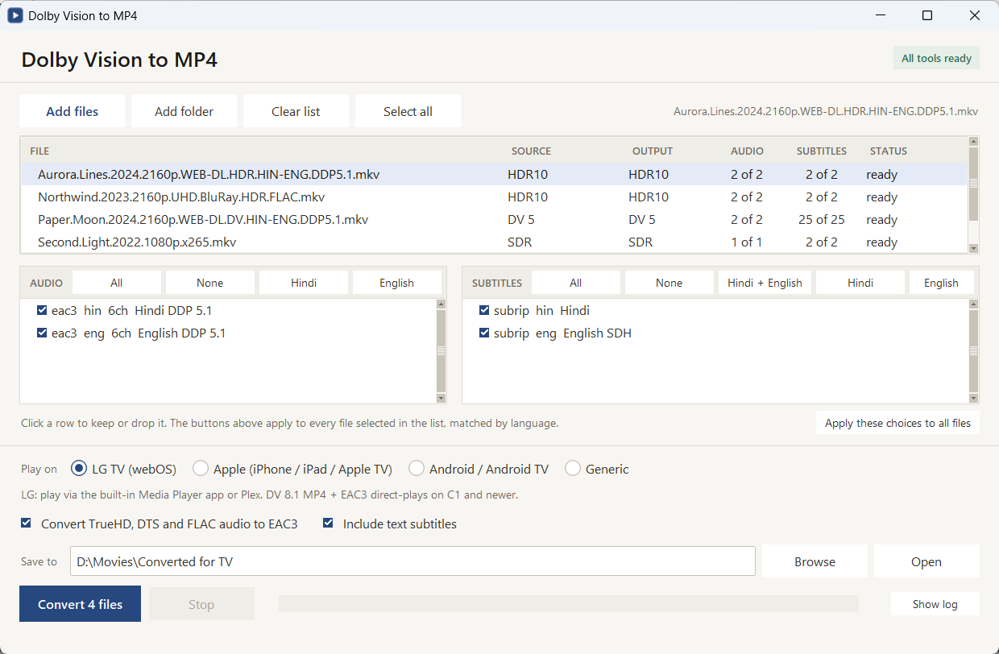
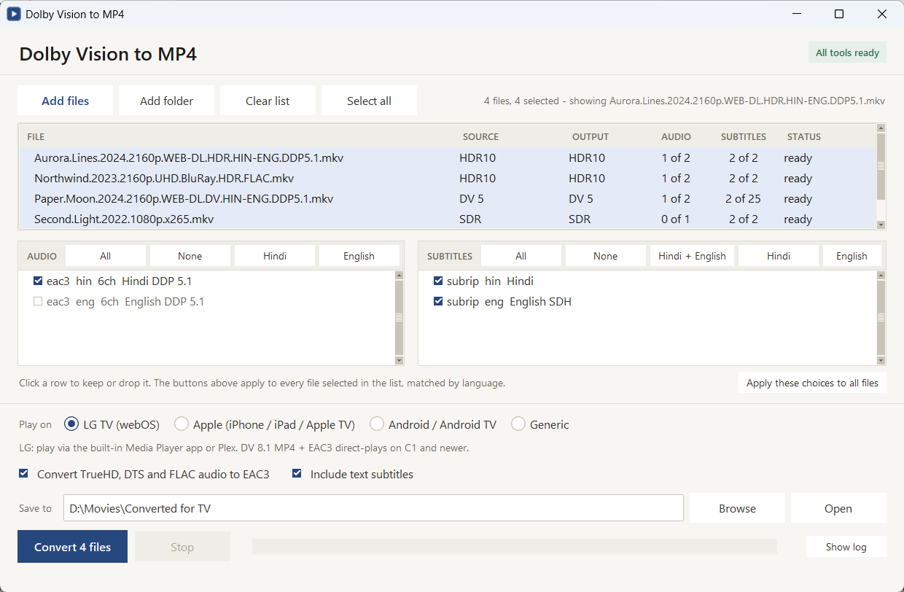
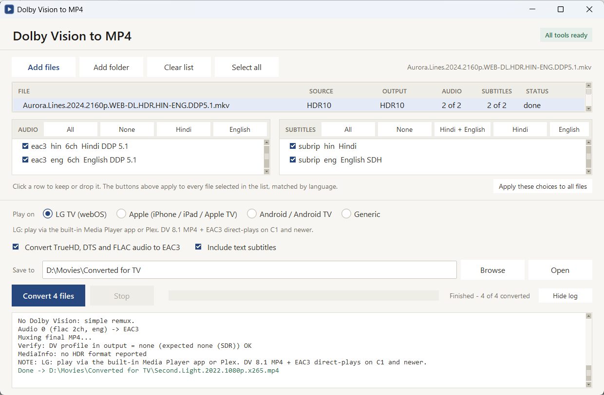

# Dolby Vision MKV → MP4

A small Windows app that remuxes **Dolby Vision MKV** files into MP4 files that LG webOS TVs,
Apple devices and Android TV will actually play — including **Profile 7 → Profile 8.1**
conversion, which is the part most TVs choke on.

**The video is never re-encoded.** It is copied bit for bit, so there is no quality loss and a
4K film takes a couple of minutes instead of a couple of hours. Your original files are never
touched; output goes to a folder you choose.



## Why this exists

An LG C-series TV plays Dolby Vision beautifully — but its built-in player wants MP4 with
DV Profile 5, 8.1 or 8.4 and EAC3 audio. A UHD Blu-ray rip is usually MKV with **Profile 7**
and TrueHD, and nothing plays it directly. The fix is a known pipeline of three command-line
tools with a dozen flags between them. This app is that pipeline with a window around it.

## Features

- **Profile 7 → 8.1 conversion.** The RPU is converted with `dovi_tool`, the enhancement layer
  is dropped, and MP4Box writes the `dvcC` box so players recognise the Dolby Vision track.
- **Everything else is passed through intact** — Profile 5, 8.1, 8.2, 8.4, HDR10, HDR10+ and
  plain SDR all remux without touching the video stream.
- **See the outcome before you start.** Each file shows what it *is* (`SOURCE`) and what it
  *will become* (`OUTPUT`), so a Profile 7 Blu-ray rip reads `DV 7.6 → DV 8.1` in the list.
- **Pick audio and subtitle tracks per file**, with a tick box per track.
- **Batch track picking.** Select every file, click **Hindi**, and each file keeps its own Hindi
  track — matched **by language**, not by track number, because track order differs between
  releases.
- **Audio that MP4 cannot carry is converted** — TrueHD, DTS, FLAC and PCM become EAC3 5.1 at
  768 kbps. EAC3, AC3 and AAC are copied untouched.
- **Subtitles**: SRT and ASS become MP4 text subtitles, with their titles and languages kept.
  PGS and VobSub are image formats MP4 cannot hold, so they are skipped with a warning.
- **Drag and drop** files or whole folders onto the window.
- **Every output is verified.** After muxing, the app re-probes the MP4 with ffprobe (and
  MediaInfo if installed) and prints the Dolby Vision profile it actually found.
- **Stop means stop.** Cancelling kills the running tools and deletes the half-written file.
- **Per-file status** through a batch: waiting → converting → done, or failed with the reason.



*One click on **Hindi** applied to all four files. The last file has no Hindi track, so it
honestly shows `0 of 1` instead of silently keeping the wrong one.*

## Install

1. Download **DV-Converter-1.0.0-setup.exe** from [Releases](../../releases/latest).
2. Run it. No admin password needed — it installs for your user only. (The first dialog can
   switch it to all users if you want that.)
3. Start it from the Start menu.

ffmpeg, MP4Box, dovi_tool and hdr10plus_tool are installed with it, in a `tools` folder next to
the app. Nothing is downloaded at runtime and nothing else on your system is touched.
To remove it: **Settings → Apps → DV Converter**.

> Windows SmartScreen will warn you the first time, because the installer is not code-signed
> (a signing certificate costs a few hundred dollars a year). Click **More info → Run anyway**.

## What it does, case by case

| Source | Output MP4 |
|---|---|
| DV Profile 7 (UHD Blu-ray) | Converted to **DV 8.1** — RPU converted, EL dropped, MP4Box-tagged |
| DV Profile 8.1 / 8.2 / 8.4 | Kept as-is, direct remux |
| DV Profile 5 | Kept as-is (tagged `dvh1`), with a warning that the player must support P5 |
| HDR10 / HDR10+ only | Plain remux |
| HDR10+ **and** Dolby Vision | Both kept, with a warning that players handle this inconsistently |
| TrueHD / DTS / FLAC / PCM audio | Converted to EAC3 5.1, 768 kbps |
| EAC3 / AC3 / AAC audio | Copied untouched |
| SRT / ASS subtitles | Converted to MP4 text subtitles (`mov_text`) |
| PGS / VobSub subtitles | Skipped, with a warning |

Two honest caveats:

- **Profile 7 FEL discs**: the enhancement layer is discarded. The picture is still full HDR10
  with Dolby Vision metadata, but the extra FEL detail is gone. Every community tool
  (`dovi_convert`, DoVi_Scripts) does the same — MP4 has no place to put it.
- **TrueHD Atmos → EAC3** loses the Atmos objects; the 5.1 bed is kept. That is an ffmpeg
  limitation, not a choice.

## How it works

```
ffprobe                 read streams, DV profile, HDR flags, chapters
  └─ Profile 7 only:
     ffmpeg             copy the video out as raw HEVC (hevc_mp4toannexb)
     dovi_tool          convert the RPU to 8.1, discard the enhancement layer
     MP4Box             write the video into MP4 with dvp=8.1, brand dby1
ffmpeg                  final mux: video copied, audio/subs per your choices, +faststart
ffprobe / MediaInfo     verify the Dolby Vision profile in the finished file
```

The video stream is only ever **copied** — `-c:v copy` at every step.

## Built with

| What | Why it is here |
|---|---|
| [ffmpeg / ffprobe](https://ffmpeg.org) | Probing, stream copying, audio conversion, the final mux |
| [dovi_tool](https://github.com/quietvoid/dovi_tool) | The only tool that converts a Profile 7 RPU to 8.1 |
| [MP4Box (GPAC)](https://github.com/gpac/gpac) | Writes the `dvcC` configuration box; ffmpeg alone will not tag raw HEVC as Dolby Vision |
| [hdr10plus_tool](https://github.com/quietvoid/hdr10plus_tool) | HDR10+ metadata checks |
| [MediaInfo](https://mediaarea.net/MediaInfo) | Optional second opinion on the finished file |
| Python 3 + tkinter | The app itself — standard library only, plus `tkinterdnd2` for drag and drop |
| [PyInstaller](https://pyinstaller.org) | Packs it into one folder with no Python install needed |
| [Inno Setup](https://jrsoftware.org/isinfo.php) | Builds the installer |

The app is **MIT** licensed. The bundled tools keep their own licences — see
[THIRD-PARTY-NOTICES.md](THIRD-PARTY-NOTICES.md).



## Where to play the result

- **LG webOS**: the built-in Media Player app or Plex. DV 8.1 MP4 with EAC3 direct-plays on C1
  and newer. Jellyfin and Kodi on the TV can play DV MKV directly, if you would rather not
  convert at all.
- **Apple (iPhone / iPad / Apple TV)**: the native player supports DV 5 and 8.4 (and 10.4 on
  newer hardware). For 8.1 files use **Infuse**, which plays them as full Dolby Vision. Plex on
  Apple TV falls back to HDR10 for Profile 8.
- **Android / Android TV**: DV 8.1 MP4 direct-plays on Shield, Google TV and DV-capable phones.
  Use Just Player or Plex if the stock player ignores the DV metadata.

## Run from source

```
pip install tkinterdnd2
python dv_converter.py
```

Tools are looked up in `tools\`, `tools\gpac\`, `C:\Program Files\GPAC`, the winget package
folders and `PATH`, in that order. `winget install Gyan.FFmpeg GPAC.GPAC` covers most of it;
drop `dovi_tool.exe` and `hdr10plus_tool.exe` into `tools\`. The app shows **All tools ready**
or names what is missing in the top right.

## Build the installer

```
powershell -ExecutionPolicy Bypass -File build.ps1
```

Downloads any missing tool into `tools\`, builds the exe with PyInstaller, and compiles
`DV-Converter-1.0.0-setup.exe` with Inno Setup (installed via winget if you do not have it).
Needs Python 3.10+ and internet on the first run. `dist\DV Converter\` is left behind as a
portable copy if you prefer that to the installer.

The whole app is one file — [`dv_converter.py`](dv_converter.py) — about 750 lines: the
conversion pipeline at the top, the interface below it.

## Credits

The Profile 7 → 8.1 flow follows what the community worked out, in particular:

- r/ffmpeg, "Convert DV Profile 7 to 8.1 using dovi_tool, mp4box and ffmpeg" (DonNETRiNO's LG C2 flow)
- r/jellyfin, "I developed a tool to convert Dolby Vision Profile 7 to 8.1" (dovi_convert, FEL caveats)
- r/LGOLED, "Guide — Playing Dolby Vision / Atmos on LG TV"
- [quietvoid/dovi_tool](https://github.com/quietvoid/dovi_tool), [nekno/DV7toDV8](https://github.com/nekno/DV7toDV8), [R3S3t9999/DoVi_Scripts](https://github.com/R3S3t9999/DoVi_Scripts)

## License

[MIT](LICENSE) © Param Patel. Issues and pull requests welcome.
